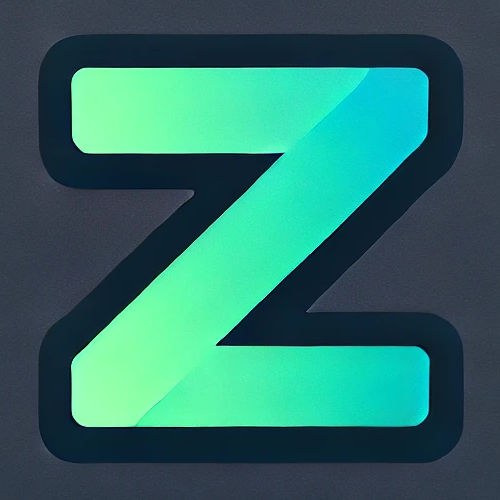

<p align="center">
  
</p>

<p align="center"><strong>A multilingual package for your applications</strong></p>

<div align="center">

[](https://badge.fury.io/js/@zoai%2Fcore)


<a href="https://twitter.com/intent/follow?screen_name=GhMaziyar">
  
</a>

</div>

---

# 📦 zoai

> From **Z**ed **to** **A** **I**nternational – A lightweight, type-safe, platform-agnostic multilingual package for JavaScript and TypeScript environments.

---

## 📚 Table of Contents

- [✨ Features](#-features)
- [📥 Installation](#-installation)
- [🚀 Usage](#-usage)
  - [🧑‍💻 TypeScript Example](#-typescript-example)
  - [🧾 Pure JavaScript Example](#-pure-javascript-example)
  - [📘 Enum & Dynamic Access Example](#-enum--dynamic-access-example)
  - [🌐 Multi-language Support Example](#-multi-language-support-example)
  - [🔢 Plurals](#-plurals)
  - [↔️ RTL and Persian](#️-rtl-and-persian)
- [📚 API Reference](#-api-reference)
- [🤝 Contributing](#-contributing)
- [📄 License](#-license)
- [🙌 Credits](#-credits)

---

## ✨ Features

- 🌍 Simple and flexible translation system
- 🧠 Type-safe API with `as const` support
- 🔀 Supports nested keys and placeholders
- 🔢 Plurals via `Intl.PluralRules`, with a `zero` form
- 🪂 Fallback locale for missing keys
- ↔️ RTL aware: `dir()` for Persian, Arabic, Hebrew…, plus locale digits (`۱۲۳`)
- ⚛️ Bindings for [SolidJS](../zoai-solid) and [React](../zoai-react)
- 🔒 Immutable language objects
- ⚡ Zero runtime dependencies
- 🧩 Works in both JavaScript and TypeScript
- 📱 **Platform-agnostic**: usable in web, Node.js, mobile, or CLI apps

---

## 📥 Installation

```bash
# Using pnpm
pnpm add @zoai/core

# Or yarn
yarn add @zoai/core

# Or npm
npm install @zoai/core
```

---

## 🚀 Usage

### 🧑‍💻 TypeScript Example

```ts
import { ZOAI } from "@zoai/core";

const zoai = new ZOAI({
  helloWorld: "Hello World",
  goodbyeWorld: "Goodbye World",
  helloBye: "Hello {{name}}",
  nested: {
    children: "Nested children {{index}}",
  },
} as const);

console.log(zoai.t("helloWorld")); // Hello World
console.log(zoai.t("goodbyeWorld")); // Goodbye World
console.log(zoai.t("helloBye", { name: "John" })); // Hello John
console.log(zoai.t("nested.children", { index: 1 })); // Nested children 1
```

---

### 🧾 Pure JavaScript Example

```js
import ZOAI from "@zoai/core";

const lang = Object.freeze({
  hello: "hello {{name}} {{age}}",
});

const zoai = new ZOAI(lang);

console.log(zoai.t("hello", { name: "John", age: 20 }));
// Output: hello John 20
```

---

### 📘 Enum & Dynamic Access Example

Use enums and dynamic keys safely with `zoai`. Lowercasing is optional — as long as keys match your type definition, type safety is preserved.

```ts
import ZOAI from "@zoai/core";

const enum Animal {
  Pinguin = "Pinguin",
  Lion = "Lion",
  Tiger = "Tiger",
  Bear = "Bear",
  Dog = "Dog",
  Cat = "Cat",
  Mouse = "Mouse",
  Bird = "Bird",
}

const lang = {
  animals: {
    [Animal.Pinguin.toLowerCase()]: "Pinguin",
    [Animal.Lion.toLowerCase()]: "Lion",
    [Animal.Tiger.toLowerCase()]: "Tiger",
    [Animal.Bear.toLowerCase()]: "Bear",
    [Animal.Dog.toLowerCase()]: "Dog",
    [Animal.Cat.toLowerCase()]: "Cat",
    [Animal.Mouse.toLowerCase()]: "Mouse",
    [Animal.Bird.toLowerCase()]: "Bird",
  },
} as const;

const zoai = new ZOAI(lang);

console.log(zoai.t("animals.Pinguin")); // Pinguin

const data = ["lion", "tiger", "bear", "dog", "cat", "mouse", "bird"] as const;

for (const key of data) {
  console.log(zoai.t(`animals.${key}`));
}
// Output:
// Lion
// Tiger
// Bear
// Dog
// Cat
// Mouse
// Bird
```

> ✅ **Note:** Using `.toLowerCase()` is optional. As long as your keys are consistent with the type definition, you still get full type safety with `zoai`.

### 🌐 Multi-language Support Example

Use the `createLocalize` function to create a localization utility that supports multiple languages and allows switching between them.

```ts
import { createLocalize } from "@zoai/core";

const langs = {
  en: {
    hello: "Hello",
    greeting: "Hello {{name}}",
  },
  fr: {
    hello: "Bonjour",
    greeting: "Bonjour {{name}}",
  },
  es: {
    hello: "Hola",
    greeting: "Hola {{name}}",
  },
} as const;

const translation = createLocalize(langs, {
  defaultLocale: "en",
});

console.log(translation.t("hello")); // Hello
console.log(translation.t("greeting", { name: "John" })); // Hello John

translation.setLocale("fr");
console.log(translation.t("hello")); // Bonjour
console.log(translation.t("greeting", { name: "John" })); // Bonjour John

console.log(translation.getLocale()); // fr
```

### 🔢 Plurals

A leaf with an `other` key is a plural. Pass a numeric `count`; the form is picked with `Intl.PluralRules` for the active locale. `zero` is used for exactly 0 when present.

```ts
const zoai = new ZOAI({
  gems: { zero: "No gems", one: "{{count}} gem", other: "{{count}} gems" },
} as const);

zoai.t("gems", { count: 0 }); // No gems
zoai.t("gems", { count: 1 }); // 1 gem
zoai.t("gems", { count: 7 }); // 7 gems
```

### ↔️ RTL and Persian

```ts
import { createLocalize } from "@zoai/core";

const i18n = createLocalize(
  {
    en: { score: "Score {{points}}", onlyEnglish: "Beta" },
    fa: { score: "امتیاز {{points}}" },
  } as const,
  { defaultLocale: "en", formatNumbers: true },
);

i18n.setLocale("fa");
i18n.t("score", { points: 2048 }); // امتیاز ۲٬۰۴۸
i18n.dir(); // "rtl"
document.documentElement.dir = i18n.dir();

// Missing in fa → falls back to the default locale at runtime,
// and is a type error until every locale has it.
i18n.has("onlyEnglish"); // true

i18n.subscribe((locale) => console.log("now", locale));
```

`getDirection("fa-IR")` and `matchLocale(navigator.languages, ["en", "fa"])` are exported as standalone helpers.

---

## 📚 API Reference

### `new Zoai(dictionary: Record<string, string | object>)`

Creates a new Zoai instance with your language map.

### `new ZOAI(dictionary, options?: { locale?, formatNumbers?, fallback? })`

Options set the locale used for plurals and number formatting.

### `.t(path: string, values?: Record<string, string | number>): string`

Translates a string key (supports dot notation) and interpolates placeholders.

#### Parameters:

| Name   | Type                | Description                                      |
| ------ | ------------------- | ------------------------------------------------ |
| path   | `string`            | Translation key (e.g. `home.title`, `button.ok`) |
| values | `Record<string, T>` | (Optional) Interpolation values for placeholders |

### `createLocalize(data: Record<K, T>, options: { defaultLocale?: L })`

Creates a localization utility with support for multiple languages.

#### Parameters:

| Name                   | Type           | Description                                                        |
| ---------------------- | -------------- | ------------------------------------------------------------------ |
| data                   | `Record<K, T>` | Object containing translations by locale                           |
| options                | `Object`       | Configuration options                                              |
| options.defaultLocale  | `L`            | (Optional) Default locale to use                                   |
| options.fallbackLocale | `L \| false`   | (Optional) Locale for missing keys; defaults to the initial locale |
| options.formatNumbers  | `boolean`      | (Optional) Format number placeholders for the locale               |

#### Returns:

An object with the following methods:

| Method       | Description                                   |
| ------------ | --------------------------------------------- |
| t            | Translate a key with optional placeholders    |
| setLocale    | Change the current locale                     |
| getLocale    | Get the current locale                        |
| locales      | All available locales                         |
| has          | Whether a key exists (with fallback)          |
| dir          | `"ltr"` or `"rtl"` for a locale               |
| formatNumber | Locale-aware number formatting                |
| subscribe    | Listen to locale changes; returns unsubscribe |

---

## 🤝 Contributing

Contributions, ideas, and feature requests are welcome!  
Please see [CONTRIBUTING.md](./CONTRIBUTING.md) for development setup and guidelines.

---

## 📄 License

This project is licensed under the MIT License.  
See the [LICENSE](./LICENSE) file for more details.

---

## 🙌 Credits

Created with ❤️ by [Maziyar Gh](https://github.com/maziyargh83)

---
